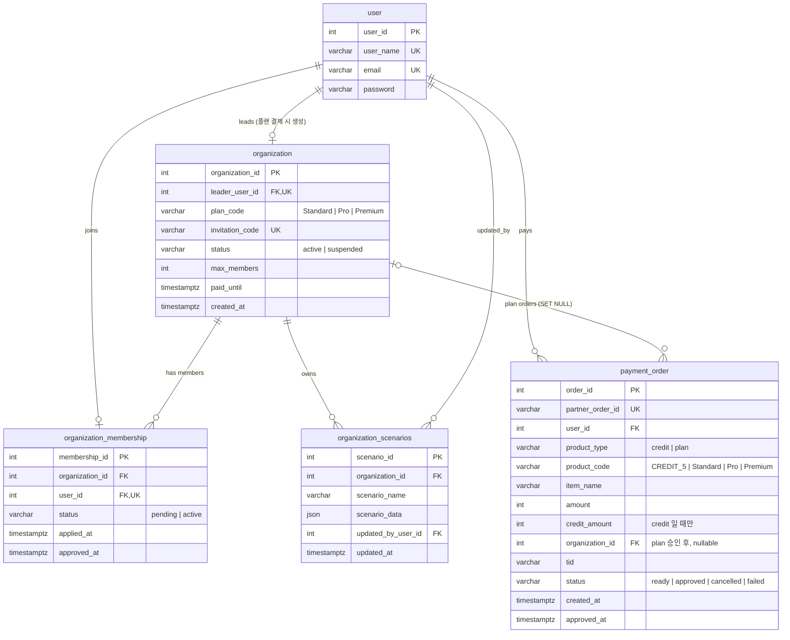

# 1. Overview

### 1.1. Tech Stack

# 2. 로컬 실행 방법

### 2.1. 가상 환경 설정

```bash
python3.12 -m venv .venv
source .venv/bin/activate
```

### 2.2. 가상 환경 필요 패키지 설치

```
pip install -U pip
pip install -r requirements.txt
```

### 2.2. 초기 .env 설정

```bash
cd BE
cp .env.example 
#이후, .env 파일 채우기 필요
```

### 2.3. Docker 실행

```bash
docker compose -f docker-compose.local.yml up --build
```

# 3. API 설명

# 4. 테스트 방법
- Unit Test

```bash
pytest -v
```

- Integration Test

```bash
docker compose -f docker-compose.local.yml up --build
pytest --integration -v
```


# 4. BE ERD

> 모든 사용자는 **개인 계정**으로 가입합니다. 이후 `CREDIT_5`(크레딧 5회권)를 결제하거나 조합 플랜(`Standard`/`Pro`/`Premium`)을 결제할 수 있으며,
> 첫 플랜 결제가 승인되는 시점에 `organization` 이 생성되고 결제자가 조합장이 됩니다. 결제 이력은 상품 종류와 관계없이 `payment_order` 한 테이블에 저장됩니다.



# 5. BE System Architecture

# 6. BE Directory Architecture
